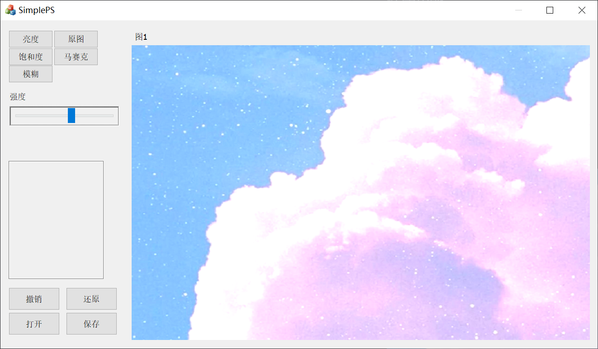
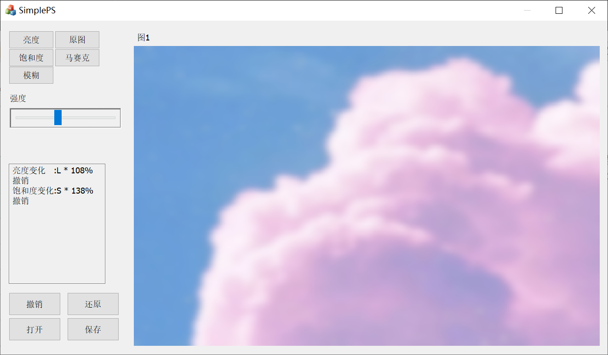
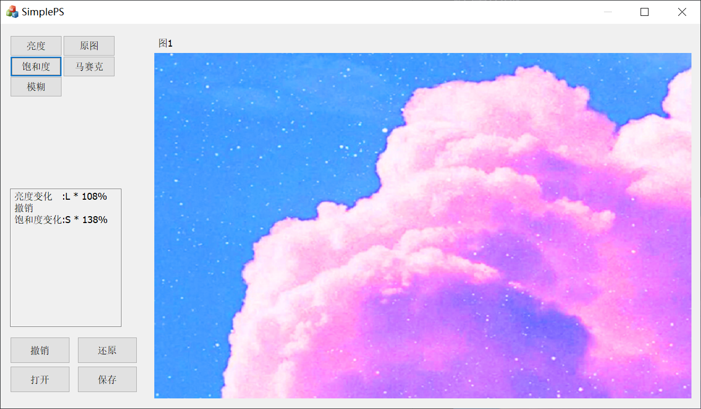
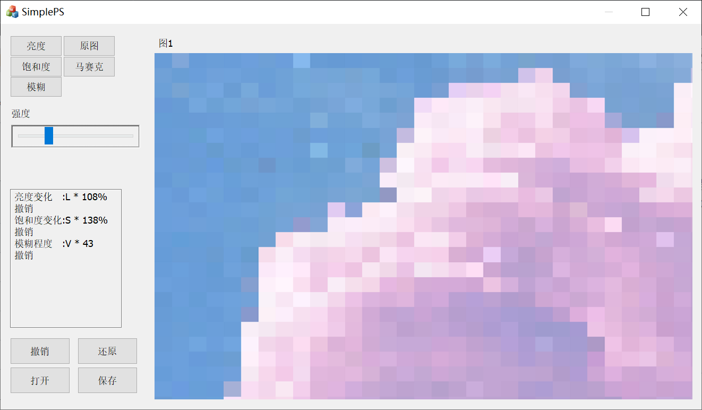

# 一个简单的 Ps 程序

## 环境

Visual Studio 2022

## 图片修改方法

1. 亮度

2. 马赛克

3. 饱和度

4. 模糊(高斯模糊)

## 程序功能

1. 打开图片

2. 修改图片

3. 修改回撤

4. 恢复图片

5. 保存图片

## 测试

1. 原图

2. 亮度修改

3. 高斯模糊

4. 饱和度修改

5. 马赛克

## _参考_

[karlMarx1818/Lighthouse](https://github.com/karlMarx1818/Lighthouse/)
